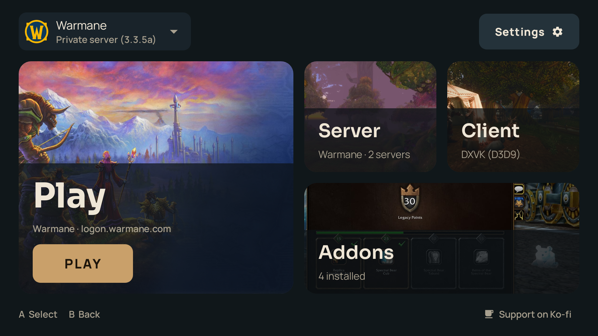
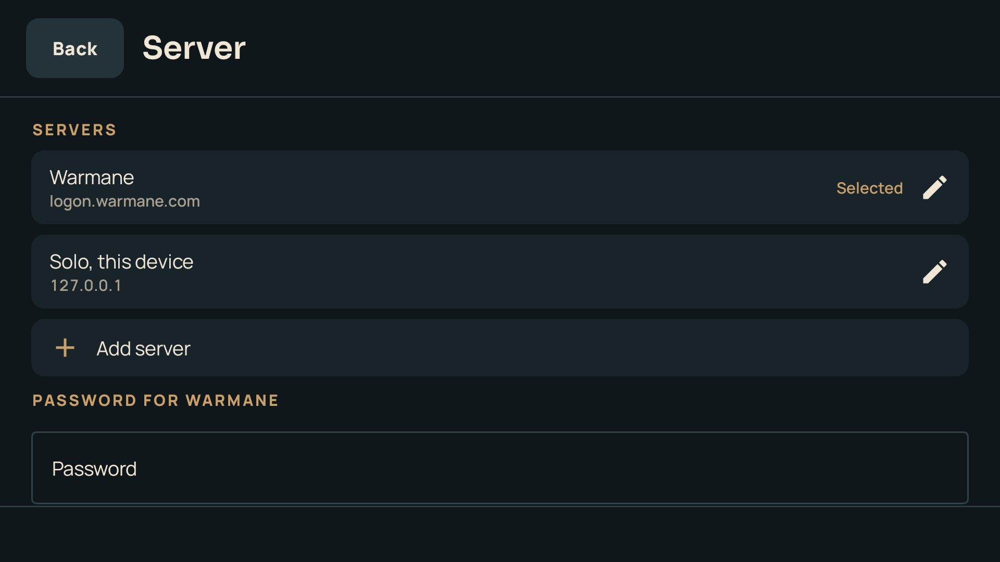
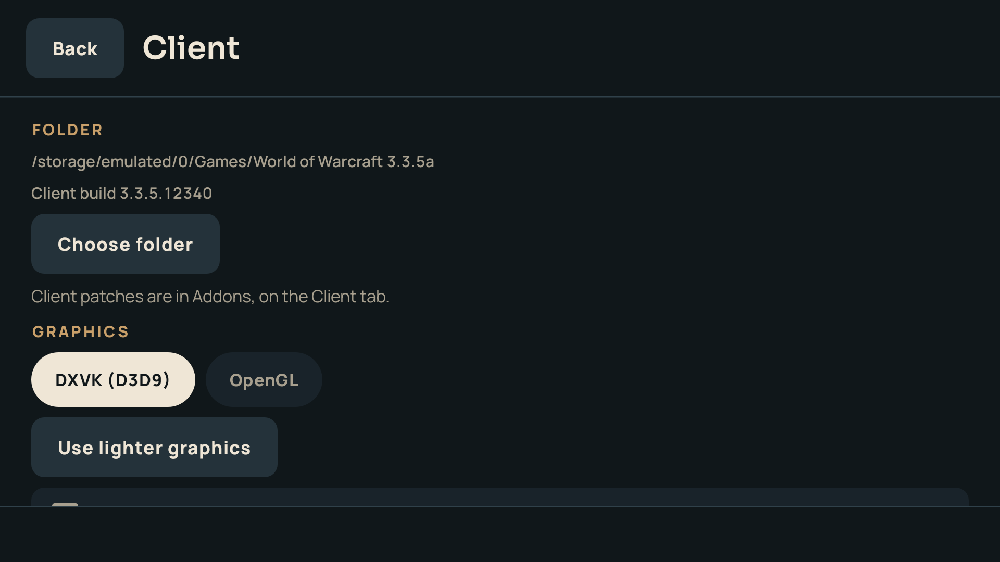
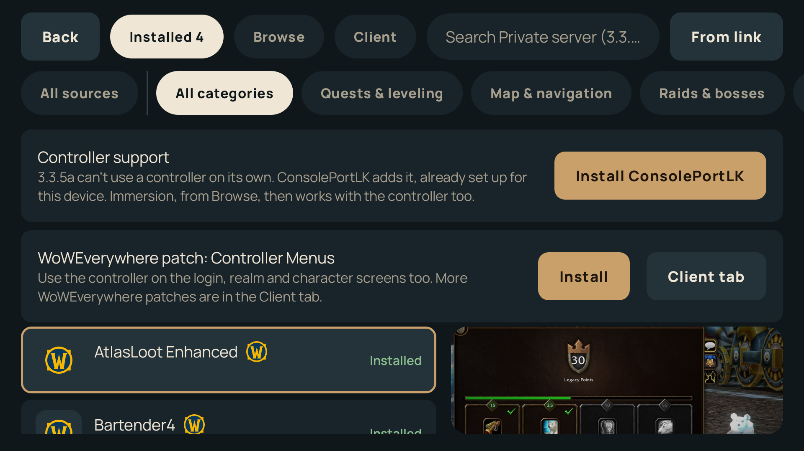
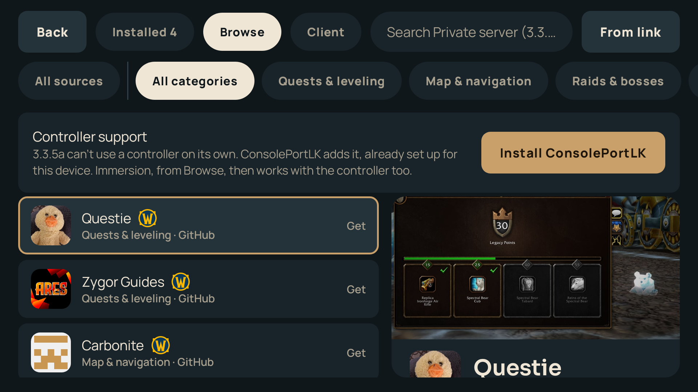
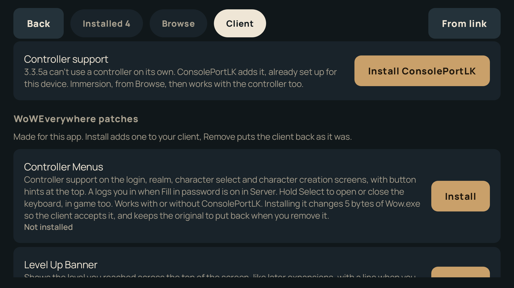
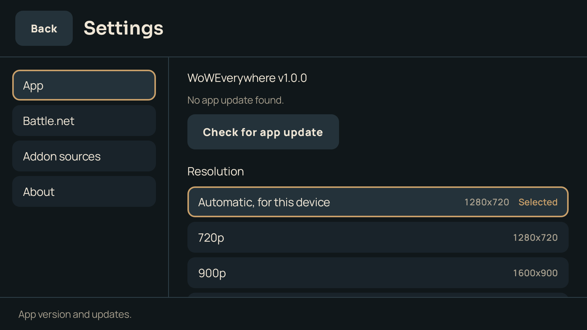

<div align="center">

# WoWEverywhere

**World of Warcraft on Snapdragon Android handhelds: WoW Forever, the official Classic versions and private servers. No PC needed.**

[](https://github.com/danielnoam/WoWAndroWhere/releases/latest)
[](https://github.com/danielnoam/WoWAndroWhere/releases)
[](LICENSE)



</div>

> [!NOTE]
> **This is a fork.** WoWEverywhere is built on [WoW Foreverywhere](https://github.com/YoruDev-Ryland/WoWForeverywhere) by YoruDev-Ryland, which is itself built on [wow-forever-android](https://github.com/jaredgei/wow-forever-android) by jaredgei. All the work that makes the game run on Android is theirs. If you only play WoW Forever, the upstream app is the one to use. See [Credits](#credits).

## Why this fork

WoW Foreverywhere is made for Blizzard's WoW Forever, and private servers are outside its scope. This fork exists to play private servers, Warmane's 3.3.5a in particular, on a handheld with a controller.

What is different from upstream:

- **Private servers.** Your own 1.12.1, 2.4.3, 3.3.5a, 4.3.4 or 5.4.8 client runs through Box64, with a list of servers, saved passwords and the realm set for you.
- **Controller on the login screens.** Controller Menus, our own add-on for 3.3.5a, lets the controller drive the login, realm, character select and character creation screens.
- **Your own server.** A solo 3.3.5a server that the app sets up and runs on the handheld, or one you run on your PC.
- **Profiles.** Several game setups side by side, each with its own version, folder, addons and servers.
- **3.3.5a addons.** A catalog of over 30 maintained 3.3.5a backports, a switch for each of your client's patch files, and one-tap ConsolePortLK.
- **Its own releases.** Signed with this fork's key and updated from this repository. CurseForge uses your own API key, never a shared proxy.

## Contents

- [Why this fork](#why-this-fork)
- [Features](#features)
- [Screenshots](#screenshots)
- [Requirements](#requirements)
- [Getting started](#getting-started)
- [Private servers](#private-servers)
- [Addons](#addons)
- [How your logins are stored](#how-your-logins-are-stored)
- [Troubleshooting](#troubleshooting)
- [Building from source](#building-from-source)
- [Credits](#credits)
- [License](#license)

## Features

**Playing**
- Runs Blizzard's Windows ARM64 client natively under Proton ARM64EC, DXVK and a tuned Turnip Vulkan driver for Adreno GPUs. Private server clients, which are 32-bit x86, run through Box64.
- Every screen works with a controller: D-pad and stick to move, A to select, B to go back, L1 and R1 to switch profiles.
- Choose the game's resolution (Automatic, 720p, 900p, 1080p or Native), for every profile.
- Touchscreen mode in the in-game menu: a tap clicks where your finger is.

**WoW Forever and official versions**
- Downloads the game from Blizzard's servers to internal storage or an SD card, in the background, with pause, resume and file checks.
- Finds an install you already have, including one copied from a PC, and keeps it updated.
- Signs you in with a saved Battle.net login, and lets you pick your Battle.net region.
- Classic Era, Burning Crusade Anniversary, Mists of Pandaria Classic and Retail are there too, as experimental versions.

**Private servers**
- One Private server choice for new profiles: pick your client folder and the app reads its version from Wow.exe.
- Several saved servers per profile, each with its own account and encrypted password, switched on the login screen with L1 and R1.
- Controller Menus (3.3.5a): controller support and button hints on the login, realm, character select and character creation screens, log in with A, and hold Select for the keyboard.
- Your own server (3.3.5a, experimental): the app downloads, sets up and runs a solo AzerothCore server on the device, starts it when you press Play and stops it when the game closes.
- Client options: DXVK or OpenGL renderer, lighter graphics in one tap, faster emulation, a performance overlay and a log you can share.

**Addons**
- Browse, search, install, update and remove addons from CurseForge, Wago, WoWInterface and a GitHub catalog, with dependencies handled.
- The 3.3.5a catalog lists maintained backports such as Questie, Immersion and Compact Raid Frames.
- The Client tab switches your client's patch files on and off (with the WotLK HD pack's rules) and installs our own Controller Menus and Level Up Banner.

The full list, with the version each feature came in, is in [DONE.md](DONE.md). What changed in each release is in the [changelog](CHANGELOG.md).

## Screenshots

<p align="center">
  
  
</p>
<p align="center">
  
  
</p>
<p align="center">
  
  
</p>

> [!NOTE]
> WoWEverywhere is an unofficial community project. It is not affiliated with or endorsed by Blizzard Entertainment. The app and this repository contain no Blizzard game files. WoW Forever and the official versions are downloaded from Blizzard's servers with your own Battle.net account. For private servers you bring your own client.

## Requirements

| | |
| :--- | :--- |
| **Chip** | Snapdragon 8 series with an Adreno 7xx or 8xx GPU |
| **Android** | Android 10 or newer, 64-bit |
| **Storage** | About 80 GB free for WoW Forever, or the size of your private server client, plus about 4 GB of internal storage for the app |
| **Account** | A Battle.net account for WoW Forever and the official versions, or an account on your private server |

Developed and tested on the **AYN Odin 3** (Snapdragon 8 Elite) with 3.3.5a on Warmane. Upstream reports WoW Forever working on the AYN Thor, Retroid Pocket 6, RedMagic 11 Pro and Samsung Galaxy S23 and newer. If you try another device, please [open an issue](https://github.com/danielnoam/WoWAndroWhere/issues) with the result.

## Getting started

1. Download **WoWEverywhere.apk** from the [latest release](https://github.com/danielnoam/WoWAndroWhere/releases/latest) and open it on your device. Android asks you to allow installs from your browser or file manager the first time.
2. Open **WoWEverywhere** and make a profile: pick **WoW Forever**, another official version, or **Private server**.
3. For WoW Forever and the official versions, the app checks your device, finds an existing install or downloads the game, and offers to save your Battle.net login. For a private server, see below.
4. Press **Play**.

> [!IMPORTANT]
> If you used WoW AndroWhere (this app's old name), it updates in place and keeps everything. If you used the upstream WoW Foreverywhere app, uninstall it first: this fork is signed with its own key. Your game files and addons stay on your storage.

> [!TIP]
> WoW Forever downloads about half a gigabyte up front and the rest of its world data (about 67 GB) the first time you play. Leaving the game at the login screen on Wi-Fi for a while speeds this up.

## Private servers

1. Copy your client (1.12.1, 2.4.3, 3.3.5a, 4.3.4 or 5.4.8) to the device, for example from your PC.
2. Make a **Private server** profile and choose the client folder. The app reads the version from Wow.exe, and asks if it can't.
3. On **Server**, add your server: its name, realmlist (for Warmane, `logon.warmane.com`) and account name. You can save the password too.
4. On 3.3.5a, install **Controller Menus** from **Addons → Client** to use the controller on the login screens. With **Fill in password** on, A logs you in.
5. Press **Play**.

Warmane's email code for a new location goes in the client's Authenticator field. 4.3.4 and 5.4.8 are much heavier than 3.3.5a under emulation, so turn on **Faster emulation** and **Use lighter graphics** on **Client**.

## Addons

The addon browser brings together CurseForge, Wago, WoWInterface and GitHub. The same addon listed on several sites appears once, with a link to each site. Addons already in the game's folder are recognized, the home screen shows how many have updates, and **Update all** installs them in one go. You can also paste a GitHub repository or a `.zip` link to install something that isn't listed.

| Source | What you get |
| :--- | :--- |
| **GitHub catalog** | For WoW Forever, popular addons with GitHub releases ([`catalog/sources.json`](catalog/sources.json)). For 3.3.5a, maintained backports ([`catalog/wotlk335.json`](catalog/wotlk335.json)). Both refresh every night. |
| **WoWInterface** | The full WoWInterface catalog, filtered to your game version. |
| **CurseForge** | Official versions only. Needs your own CurseForge API key or a proxy you run, entered in Settings. |
| **Wago Addons** | Official versions only, in builds made with a Wago API key. |

To suggest an addon, open a pull request that adds its repository to the catalog file.

## How your logins are stored

Saving a login is optional, and nothing leaves the device except the login itself, sent to the game.

- Battle.net logins and private server passwords are sealed with AES-256-GCM using a key held by the Android Keystore, and are excluded from cloud backups and phone-to-phone transfers. The login form blocks screenshots.
- WoW Forever reads your Battle.net login from a short-lived `login.txt` in the game folder. The app wipes it about 20 seconds after the game reads it, or after ten minutes at most, and when the game closes.
- On private servers, **Fill in password** hands the saved password to Controller Menus for one launch and wipes it right after the client reads it, or after three minutes at most.

For those few seconds the password sits in plain text in the game folder, where any app with full storage access could read it. If that is a concern, don't save it and type it in the game instead.

## Troubleshooting

| Problem | What to do |
| :--- | :--- |
| *CAS system was unable to initialize* | The WoW Forever folder is missing `.build.info`. Run **Game files → Install or repair**, or copy the file again from your PC install. |
| *No realms available* | WoW Forever is out of date. Open the app with Wi-Fi on and accept the update. |
| A private server client doesn't start | On **Client**, turn on **Save a log**, play once, and share the log when the game closes. Try the OpenGL renderer. |
| The keyboard doesn't appear in the game | On 3.3.5a with Controller Menus, hold Select. Otherwise press Back and choose Keyboard. If it still doesn't show, force-stop Gboard. |
| "This device can't run the game" | The device has no Adreno GPU. The game needs a Snapdragon chip. |

## Building from source

Requirements: JDK 17 or 21 and the Android SDK.

```bash
tools/fetch_components.sh          # Wine, DXVK and Turnip runtime archives (~130 MB, checksummed)
./gradlew assembleModernRelease    # app/build/outputs/apk/modern/release/app-modern-release.apk
./gradlew testModernDebugUnitTest
```

No API keys are built into the app. To enable Wago, put its key in `local.properties`, which is never committed:

```properties
WAGO_API_KEY=...
```

Release builds are signed with `app/keystores/keystore.properties` when it exists and fall back to the debug key otherwise. The README screenshots are rendered from the app's own screens by the **README screenshots** workflow.

## Credits

WoWEverywhere is a fork of [**WoW Foreverywhere**](https://github.com/YoruDev-Ryland/WoWForeverywhere) by **YoruDev-Ryland**, which built the launcher, installer and addon manager. That is a fork of [**wow-forever-android**](https://github.com/jaredgei/wow-forever-android) by **jaredgei**, which made WoW Forever run on Android handhelds in the first place. If this app saves you time, consider supporting WoW Foreverywhere on [Ko-fi](https://ko-fi.com/rkremeier). This fork takes no donations.

They build on:

- [**GameNative**](https://github.com/utkarshdalal/GameNative), [**Pluvia**](https://github.com/oxters168/Pluvia), [**Winlator**](https://github.com/brunodev85/winlator) and the [**Bionic Vulkan wrapper**](https://github.com/leegao/bionic-vulkan-wrapper) for the Android app, Wine container management and X server.
- The **WoW Forever RP6 community bundle** and [**arusiasotto**](https://github.com/arusiasotto/wow-forever-a840) for the tuned Proton 11 ARM64EC, DXVK and Turnip builds.
- [**Wine**](https://www.winehq.org/), [**Proton**](https://github.com/ValveSoftware/Proton), [**DXVK**](https://github.com/doitsujin/dxvk), [**Mesa**](https://mesa3d.org/), [**FEX-Emu**](https://github.com/FEX-Emu/FEX), [**Box64**](https://github.com/ptitSeb/box64) and [**PulseAudio**](https://www.freedesktop.org/wiki/Software/PulseAudio/).

For private servers, this fork also uses:

- [**AzerothCore**](https://github.com/azerothcore/azerothcore-wotlk) for Your own server, built for Android with [**Termux**](https://github.com/termux/termux-packages) packages.
- [**ConsolePortLK**](https://github.com/leoaviana/ConsolePortLK) by leoaviana, installed on request.
- The authors of the 3.3.5a backports in the addon catalog, such as RomanSpector's Compact Raid Frames and Loss of Control Alerts. Each addon is downloaded from its author's own repository.

World of Warcraft, WoW Forever and the artwork shown in the app are owned by Blizzard Entertainment. The app loads that artwork from Blizzard's own servers. Full third-party license details are in [`THIRD_PARTY_NOTICES`](THIRD_PARTY_NOTICES).

## License

[GPL-3.0](LICENSE), like the projects it is built on. The bundled runtime components carry their own licenses; see [`THIRD_PARTY_NOTICES`](THIRD_PARTY_NOTICES).
